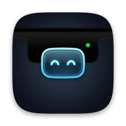
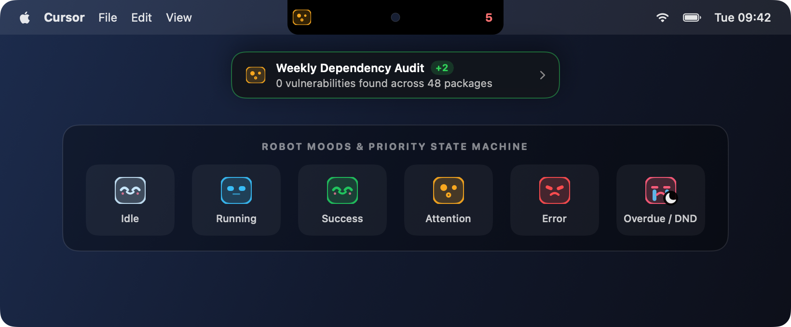
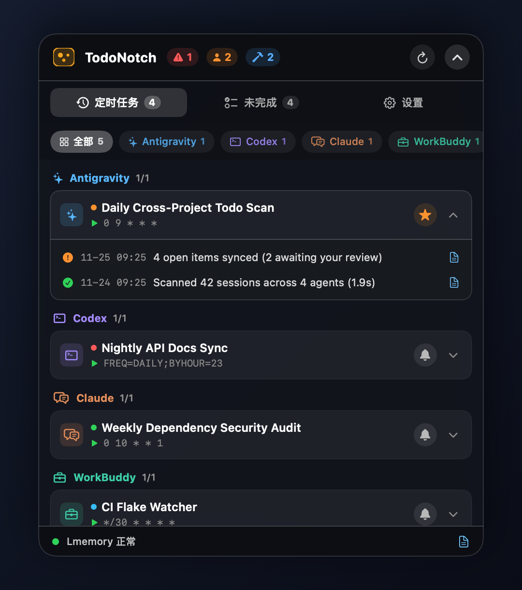
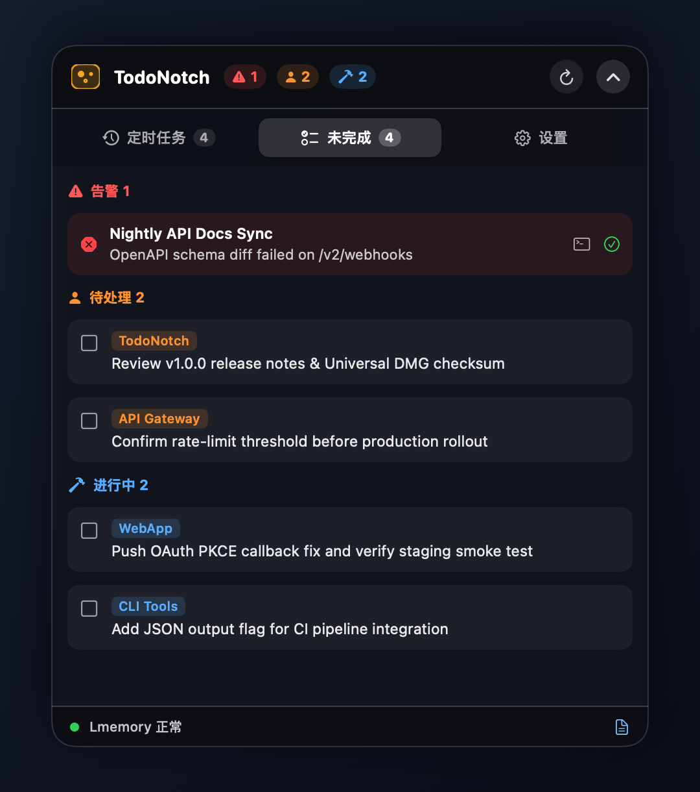
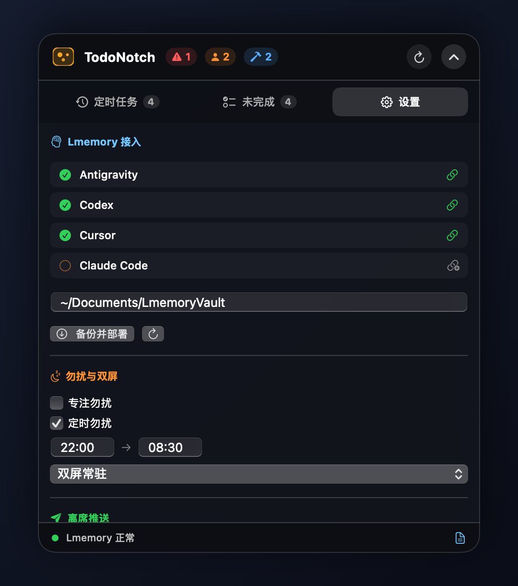

<div align="center">
  
  <h1>TodoNotch</h1>
  <p>Native macOS 14+ MacBook notch companion &amp; AI Agent scheduled-task notification hub</p>
  <p>
    <a href="README.md">English</a> | <a href="README.zh-CN.md">简体中文</a>
  </p>
</div>

**TodoNotch** is a native macOS 14+ (Swift 6 + SwiftUI/AppKit, zero Electron) MacBook notch companion and AI Agent scheduled-task notification hub.

It lives quietly inside your MacBook notch (or menu bar area on external displays), discovers scheduled automations across your local AI coding agents in read-only mode, tracks cross-project daily todos, and alerts you with an expressive animated pixel-vector robot—without stealing focus.

---

## Screenshots

<p align="center">
  
</p>

<table>
  <tr>
    <td align="center" width="33%">
      <br />
      <sub><b>Scheduled Tasks &amp; 7-Day History</b></sub>
    </td>
    <td align="center" width="33%">
      <br />
      <sub><b>Unread Alerts &amp; Daily Todos</b></sub>
    </td>
    <td align="center" width="33%">
      <br />
      <sub><b>Lmemory, DND &amp; Webhook</b></sub>
    </td>
  </tr>
</table>

---

## Features

- **Physical Notch Geometry & Multi-Screen Support**
  - Aligns flush with the MacBook notch (`0px` downward overflow, `30pt` side wings) so menu bar icons remain unobstructed.
  - Supports multi-display setups (`All Screens` or locked to a specific display ID) and renders a menu bar icon (`NSStatusItem`) for quick access.
- **18 Expressive Robot States**
  - Driven by a strict priority state machine (`overdue > error > attention > running > success > idle`).
  - Cycles through 18 custom SwiftUI vector expressions (crying, angry, dizzy, starry, love, winking, scanning, sleepy, etc.).
  - Automatically respects macOS `Reduce Motion` and overlays a Do-Not-Disturb moon badge when muted.
- **Non-Focus-Stealing Light Toast**
  - Displays a 5-second auto-dismissing toast for normal completions, pauses on hover, coalesces concurrent events, and never steals keyboard focus from your editor.
- **Zero-Intrusion Read-Only Agent Discovery**
  - Automatically scans local scheduled tasks and recent 7-day execution logs without modifying any third-party agent configs:
    - **Antigravity** (`~/.gemini/config/sidecars/*/sidecar.json` & logs)
    - **Codex** (`~/.codex/automations/*/automation.toml` & `~/.codex/sqlite/codex.db` via `SQLITE_OPEN_READONLY`)
    - **Claude Code / Claude Desktop** (`~/.claude/scheduled-tasks/`, `scheduled_tasks.json`)
    - **WorkBuddy** (`~/.workbuddy/workbuddy.db` via `SQLITE_OPEN_READONLY`)
    - **ZCode** (`~/.zcode/cli/db/db.sqlite` & `~/.zcode/v2/*.json`)
    - **macOS LaunchAgents** (`~/Library/LaunchAgents/*.plist`)
  - Open local drop-in JSON inbox (`~/Library/Application Support/TodoNotch/inbox/*.json`) for custom scripts (`scan_todos.py` included).
- **Sleep-Aware Missed-Run Detection**
  - Excludes macOS sleep intervals and applies a 5-minute wake grace period so lid-close overnight never triggers false missed-run alarms.
- **Cross-Project Daily Todo Sync & Lmemory Health**
  - Parses `<vault>/05 时间日志/每日待办.md` and writes back checkbox toggles (`- [ ]` ↔ `- [x]`) directly in place.
  - Monitors Lmemory nightly upkeep status (`<vault>/90 系统文件/自动化/夜间维护.md`) and includes a safe, idempotent Lmemory onboarding assistant (backs up configs and preserves existing vaults).
- **Do-Not-Disturb & Webhook Alerts**
  - Supports cross-midnight DND schedules (default `22:00–08:30`) and instant Focus Mode (`⌘D`).
  - Supports Webhook notifications for **Feishu / Lark**, **WeCom**, **DingTalk**, **Bark**, and **Generic JSON**, with webhook URLs encrypted in **macOS Keychain**.

---

## Installation

### Option 1: DMG Installer (Recommended)

1. Download the latest `TodoNotch-v*.dmg` from [GitHub Releases](https://github.com/TinkCarlos/TodoNotch/releases).
2. Open the `.dmg` file and drag `TodoNotch.app` into **Applications**.
3. Because the open-source release build is ad-hoc signed (not Apple-notarized), macOS Gatekeeper may warn on first launch. Clear the quarantine flag or use Right-click → Open:
   ```bash
   xattr -cr /Applications/TodoNotch.app
   open /Applications/TodoNotch.app
   ```

### Option 2: Build from Source

Requires **macOS 14.0+** and **Swift 6.0+**:

```bash
git clone https://github.com/TinkCarlos/TodoNotch.git
cd TodoNotch

# Run unit tests & Python scanner self-test
swift test
python3 scan_todos.py --self-test

# Build TodoNotch.app in place
./scripts/build-app.sh

# Or build and register LaunchAgent auto-start at login
./scripts/install.sh

# Package a compressed .dmg into dist/
./scripts/build-dmg.sh 1.0.0
```

To remove the LaunchAgent, local app support state, and built `.app` bundle (without touching your Vault or Agent configs):

```bash
./scripts/uninstall.sh
```

---

## Project Structure

```text
TodoNotch/
├── Package.swift                 # SwiftPM manifest (macOS 14+, Swift 6)
├── Assets/
│   └── AppIcon.icns              # macOS squircle app icon
├── Sources/
│   ├── TodoNotchCore/            # Domain state machines, SQLiteStore, Keychain, Watchers, PushDispatcher, LmemoryInstaller
│   └── TodoNotch/                # AppKit FloatingPanel, MultiScreenCoordinator, AppViewModel, SwiftUI Views
├── Tests/
│   └── TodoNotchTests/           # Unit & isolation tests (CoreTests)
├── scripts/
│   ├── build-app.sh              # Release build + Info.plist + bundled scan_todos.py + AppIcon.icns + ad-hoc codesign
│   ├── build-dmg.sh              # Isolated staging + compressed UDZO DMG builder
│   ├── install.sh                # Build & install LaunchAgent auto-start
│   └── uninstall.sh              # Clean removal of LaunchAgent & local TodoNotch state
├── scan_todos.py                 # Cross-agent conversation scanner (--self-test / --notify)
└── docs/
    ├── assets/                   # README logo & UI screenshots
    ├── api.md                    # Local inbox JSON & Webhook contracts
    ├── database.md               # SQLite schema & Keychain boundaries
    ├── project-notes.md          # Architecture & safety invariants
    └── features-and-regressions.md
```

---

## Documentation

- [API & Event Contracts](docs/api.md)
- [Local Storage & Database Schema](docs/database.md)
- [Architecture & Project Notes](docs/project-notes.md)
- [Features & Regression Checklist](docs/features-and-regressions.md)
