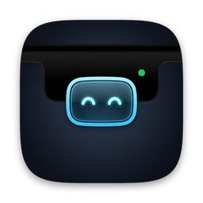
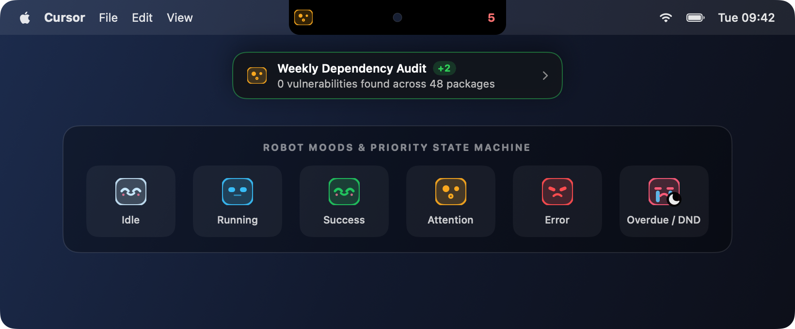
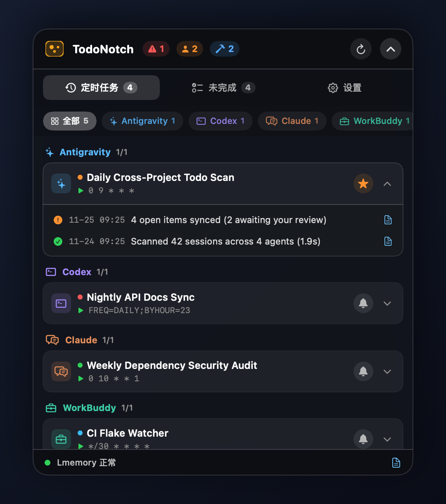
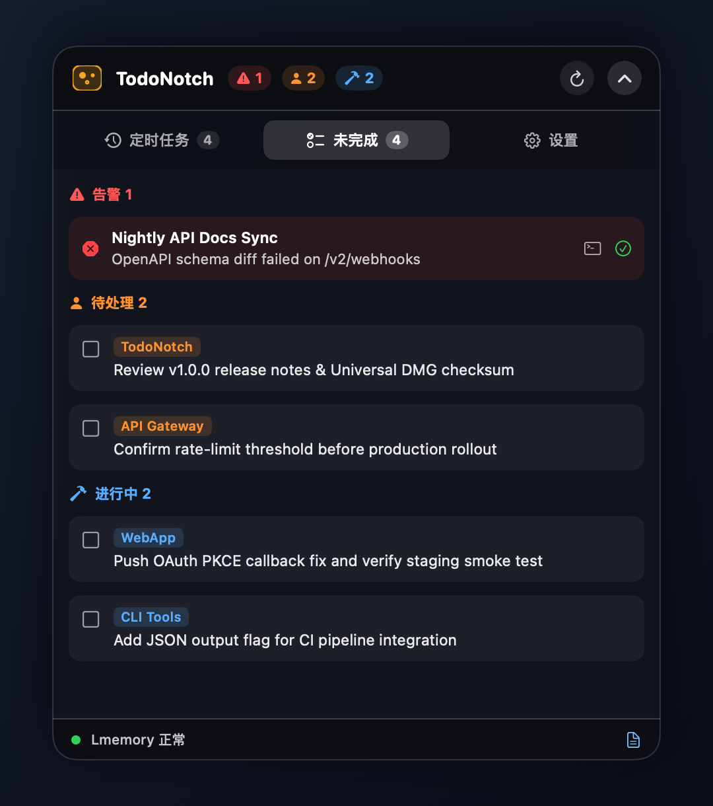
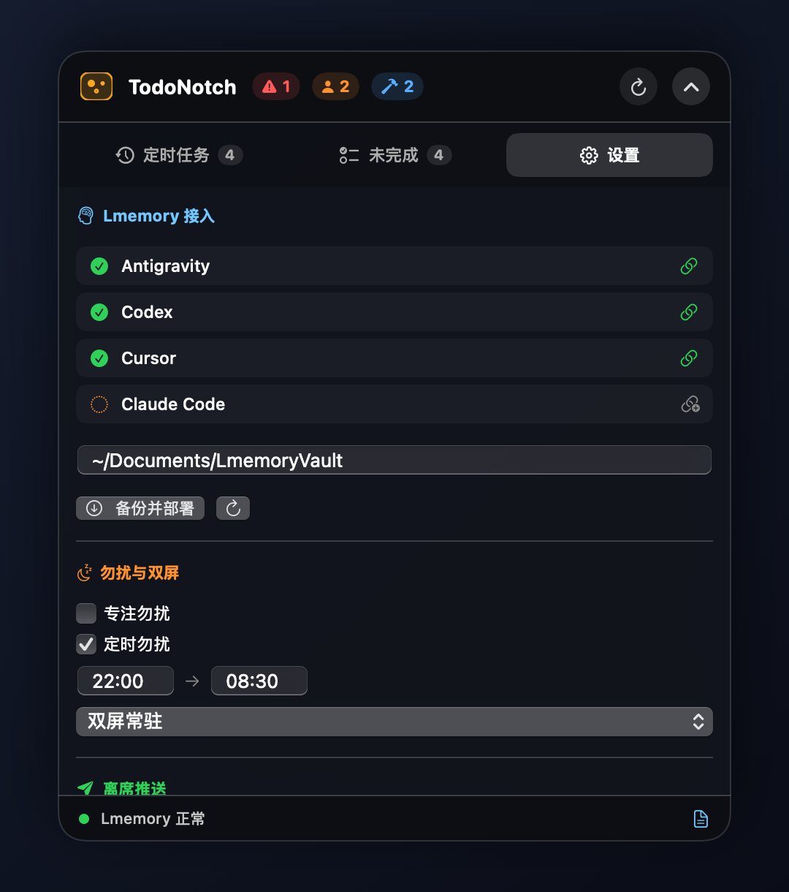

<div align="center">
  
  <h1>TodoNotch</h1>
  <p>原生 macOS 14+ MacBook 刘海伴侣与 AI Agent 定时任务通知中枢</p>
  <p>
    <a href="README.md">English</a> | <a href="README.zh-CN.md">简体中文</a>
  </p>
</div>

**TodoNotch** 是一款基于 macOS 14+ 原生技术栈（Swift 6 + SwiftUI / AppKit，零 Electron 依赖）打造的 MacBook 刘海常驻伴侣与 AI Agent 定时任务通知中枢。

它常驻在 MacBook 物理刘海两侧（外接屏自动适配顶部菜单栏区域），以**零侵入只读模式**自动发现本地多个 AI 编程工具的定时任务与运行状态，同步跨项目每日待办清单，并通过 18 种动态矢量表情的机器人及时提醒异常或待办——同时不抢占当前编辑器焦点。

---

## 界面预览

<p align="center">
  
</p>

<table>
  <tr>
    <td align="center" width="33%">
      <br />
      <sub><b>定时任务与近 7 天运行记录</b></sub>
    </td>
    <td align="center" width="33%">
      <br />
      <sub><b>未读告警与每日待办</b></sub>
    </td>
    <td align="center" width="33%">
      <br />
      <sub><b>Lmemory、勿扰双屏与推送</b></sub>
    </td>
  </tr>
</table>

---

## 核心特性

- **物理刘海几何对齐与多屏自适应**
  - 严格贴合 MacBook 刘海高度（`0px` 向下溢出，单侧耳翼 `30pt`），绝不遮挡右侧菜单栏图标。
  - 支持多显示器模式（跟随全部屏幕或锁定指定屏幕），并在系统菜单栏提供快捷入口。
- **18 种动态矢量机器人表情**
  - 由严格优先级状态机驱动：`超期/漏跑 > 报错 > 待处理 > 运行中 > 刚完成 > 空闲`。
  - 内置 18 种 SwiftUI 矢量表情（大哭、怒眉、晕眩、星星眼、爱心眼、眨眼、扫描、打盹等）。
  - 自动遵循 macOS「减弱动态效果（Reduce Motion）」设置，勿扰模式下保留最高优先级状态色并叠加静音角标。
- **不抢焦点的 5 秒轻提示**
  - 任务正常完成时弹出轻量横幅（5 秒自动收起，鼠标悬停暂停，连续完成自动合并计数），绝不打断编码输入焦点。
- **零侵入只读多工具自动发现**
  - 不修改任何外部 Agent 的原始配置文件，自动发现并展示近 7 天运行记录：
    - **Antigravity**（`~/.gemini/config/sidecars/*/sidecar.json` 及运行日志）
    - **Codex**（`~/.codex/automations/*/automation.toml` 及 `SQLITE_OPEN_READONLY` 只读 `codex.db`）
    - **Claude Code / Claude Desktop**（`~/.claude/scheduled-tasks/`、`scheduled_tasks.json`）
    - **WorkBuddy**（`SQLITE_OPEN_READONLY` 只读 `workbuddy.db`）
    - **ZCode**（`~/.zcode/cli/db/db.sqlite` 及 `~/.zcode/v2/*.json`）
    - **macOS LaunchAgents**（`~/Library/LaunchAgents/*.plist`）
  - 开放本地原子 JSON 投递目录（`~/Library/Application Support/TodoNotch/inbox/*.json`），供外部脚本（含自带 `scan_todos.py`）零改代码接入。
- **休眠剔除防误报漏跑检测**
  - 自动记录 macOS 休眠区间并在唤醒后给予 5 分钟宽限期，合盖过夜不误报漏跑，任务运行中不误报。
- **跨项目每日待办同步与 Lmemory 健康监控**
  - 解析 `<vault>/05 时间日志/每日待办.md`，支持一键勾选 `- [ ]` / `- [x]` 并精确写回原文件。
  - 监控 Lmemory 夜间维护状态（`<vault>/90 系统文件/自动化/夜间维护.md`），提供改前备份与旧 Vault 幂等复用的安全引导部署。
- **跨午夜勿扰与多平台 Webhook 推送**
  - 支持跨午夜勿扰时段（默认 `22:00–08:30`）与一键专注模式（`⌘D`）。
  - 支持 **飞书 / 企业微信 / 钉钉 / Bark / 通用 JSON** Webhook 离席推送，完整 Webhook URL 加密保存于 **macOS Keychain（钥匙串）**。

---

## 安装方式

### 方式一：DMG 安装包（推荐）

1. 前往 [GitHub Releases](https://github.com/TinkCarlos/TodoNotch/releases) 下载最新的 `TodoNotch-v*.dmg`。
2. 双击打开 `.dmg`，将 `TodoNotch.app` 拖入 **Applications（应用程序）** 文件夹。
3. 由于开源发布版采用 Ad-hoc 本地签名（未经过 Apple 公证），首次打开如遇 macOS「无法验证开发者 / 已损坏」提示，请执行以下命令清除隔离属性（或右键 → 打开）：
   ```bash
   xattr -cr /Applications/TodoNotch.app
   open /Applications/TodoNotch.app
   ```

### 方式二：源码编译运行

环境要求：**macOS 14.0+**、**Swift 6.0+**。

```bash
git clone https://github.com/TinkCarlos/TodoNotch.git
cd TodoNotch

# 运行单元测试与扫描脚本自检
swift test
python3 scan_todos.py --self-test

# 原地编译打包 TodoNotch.app
./scripts/build-app.sh

# 编译并注册开机自启 LaunchAgent
./scripts/install.sh

# 生成压缩版 macOS .dmg 安装包（输出至 dist/）
./scripts/build-dmg.sh 1.0.0
```

如需卸载 LaunchAgent、本地状态库及打包的 `.app`（不会删除你的 Vault 知识库或各 Agent 配置）：

```bash
./scripts/uninstall.sh
```

---

## 目录结构

```text
TodoNotch/
├── Package.swift                 # SwiftPM 工程配置（macOS 14+, Swift 6)
├── Assets/
│   └── AppIcon.icns              # macOS 圆角矩形应用图标
├── Sources/
│   ├── TodoNotchCore/            # 核心状态机、SQLiteStore、Keychain、只读监听、Webhook 推送、Lmemory 安装器
│   └── TodoNotch/                # AppKit 浮窗、多屏协调、AppViewModel 与 SwiftUI 视图
├── Tests/
│   └── TodoNotchTests/           # 核心单元测试与隔离集成测试（CoreTests）
├── scripts/
│   ├── build-app.sh              # Release 编译 + Info.plist + 内置 scan_todos.py + AppIcon.icns + Ad-hoc 签名
│   ├── build-dmg.sh              # 独立临时目录打包并生成 UDZO 压缩 DMG
│   ├── install.sh                # 编译并配置 LaunchAgent 开机自启
│   └── uninstall.sh              # 卸载 LaunchAgent 与本地 TodoNotch 运行状态
├── scan_todos.py                 # 跨 Agent 对话待办扫描脚本（支持 --self-test / --notify）
└── docs/
    ├── assets/                   # README Logo 与界面截图
    ├── api.md                    # 本地事件投递与 Webhook 接口契约
    ├── database.md               # SQLite 表结构与 Keychain 安全边界
    ├── project-notes.md          # 架构约定与工程红线
    └── features-and-regressions.md
```

---

## 相关文档

- [接口与事件契约](docs/api.md)
- [本地存储与数据模型](docs/database.md)
- [项目重大注意事项](docs/project-notes.md)
- [现有功能与回归清单](docs/features-and-regressions.md)
